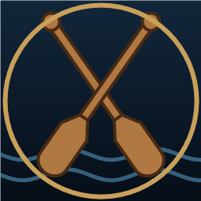
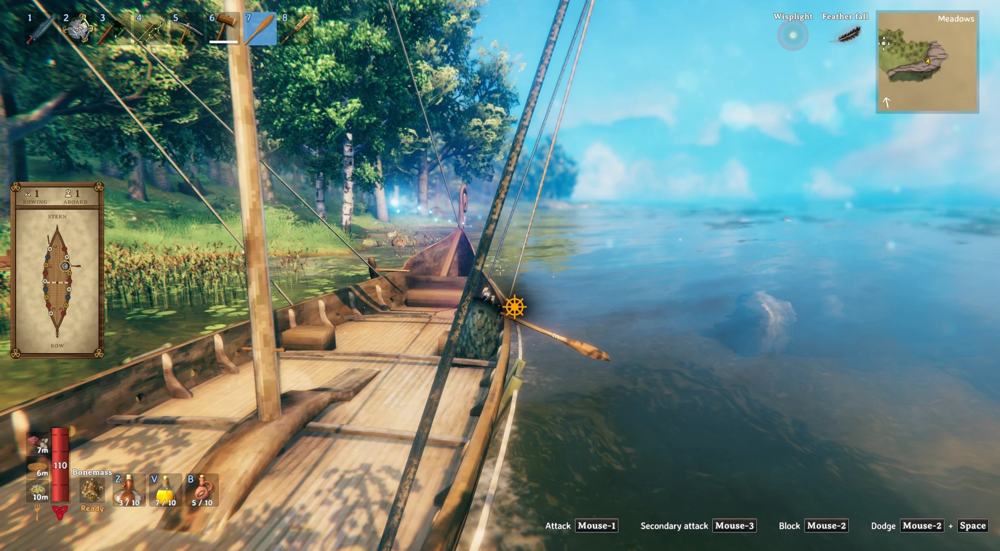
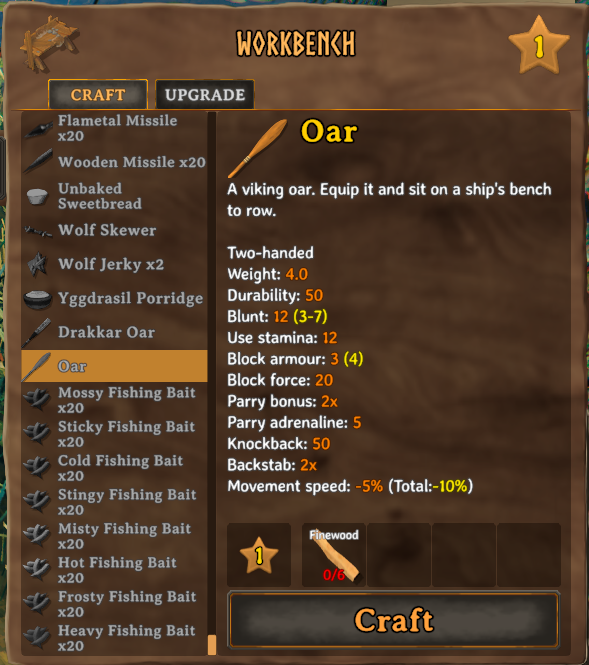
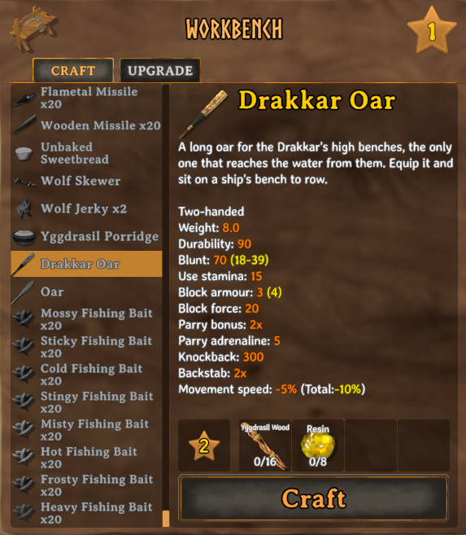
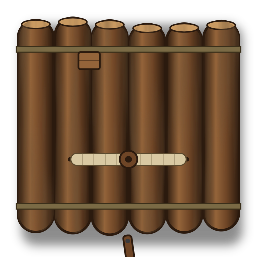
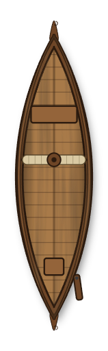
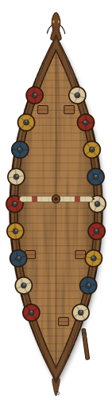
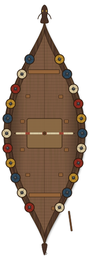
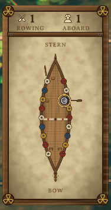

<div align="center">



# Viking Oarsmen


</div>

A [BepInEx](https://github.com/BepInEx/BepInEx) mod for **Valheim** that lets players row their ship by hand.
Craft an oar, equip it, sit on a bench: your character grabs it over the side and paddles the ship forward.
W/S shift gears just like the helm's rudder, and the more of the crew rows, the faster you go.

<!-- Absolute URLs so the images also show on Thunderstore, which ships this file without docs/. -->


## How to craft the oars

Two oars, two workbenches. Equip the oar like a weapon, climb aboard and sit on a bench.

| Oar | Drakkar Oar |
| --- | --- |
|  |  |
| **Workbench level 1**<br>6 Fine Wood<br>Rows the raft, karve and longship | **Workbench level 2**<br>16 Yggdrasil Wood, 8 Resin<br>The only oar that rows the Drakkar, and it rows every other ship too |

## Getting started in 4 steps

1. **Craft and equip.** Make the oar at the workbench and equip it like a weapon.
2. **Sit on a bench.** Board a ship and press **E** on a bench. Rowing starts automatically, in neutral.
3. **Shift gears.** **W**/**S** step through the gears, same controls as the ship's own rudder, minus steering. While rowing, W/S never stand you up.
4. **Get up.** Leave the bench with **E** or **Jump**, same as the helm. Getting up, dying or switching away from the oar stops rowing immediately.

| Gear | Reverse | Neutral | Gear 1 | Gear 2 | Gear 3 |
| --- | :---: | :---: | :---: | :---: | :---: |
| Indicator | ▼ | ● | ▲ | ▲▲ | ▲▲▲ |
| How to get there | **S** from neutral | start here | **W** from neutral | **W** again | **W** again |

If you sit on a bench without the right oar, pressing W/S tells you which one to equip.

You can row with the sail up. The two forces add together.
Only the crew on the benches row: whoever is at the helm steers, and holding on to the mast or the prow doesn't row either. The raft has no bench of its own, so the mod adds one, at the front of its left side ahead of the mast, for one rower (only players with the mod see it).

## Which oar for which ship?

| | Raft | Karve | Longship | Drakkar |
| --- | :---: | :---: | :---: | :---: |
| |  |  |  |  |
| **Oar** | yes (one bench added by the mod) | yes | yes | no |
| **Drakkar Oar** | yes | yes | yes | yes |

## Features

### Rowing

- **Oar required:** craft the oar at a tier-1 workbench (6 Fine Wood) and equip it like a weapon. Off the ship it works as one: a slow two-handed club with the battleaxe's wide sweeping swings, using the Clubs skill.
- **Drakkar Oar:** the Drakkar's benches sit too high for the oar, so it takes a longer one, painted after the Drakkar: craft it at a level-2 workbench (16 Yggdrasil Wood, 8 Resin). It is the only oar that rows the Drakkar, and it rows any other ship too. As a weapon it hits harder than the oar.
- **Gear shifting:** sitting on a bench with the oar equipped puts you in neutral automatically. W/S step through reverse, neutral and gears 1–3, exactly like steering a ship, except it never turns.
- **Crew-powered speed:** each rower adds thrust based on their gear (reverse and gears 1–3), and the crew's thrust adds up: by default a rower in gear 1 adds 8% of the push of a full sail in a strong tailwind, and one in gear 3 about 14%, up to 1.5 times that sail in total. Thrust is scaled per ship type (raft, karve, longship, drakkar), and it eases in and out over a second and a half.
- **A bench on the raft:** one crew member can sit at the front of the raft and row while another steers.
- **Helm keeps control:** rowing only pushes along the bow and never turns the ship. The helmsman steers with the vanilla rudder and can't row; only the crew on the benches can.
- **Stamina cost:** each stroke costs stamina, on a per-gear cadence (gears 2 and 3 stroke faster, so they drain faster). Running out withholds that gear's thrust — you keep your selected gear, and it resumes on its own once stamina refills, like swinging a weapon without enough stamina.

### Visuals

- **Rowing animation:** the oar is a custom model held in both hands, and the rower sits facing the stern. The stroke is a real animation: the blade enters the water at the catch, the body pulls back through the drive, then the oar lifts out and swings forward. Stroke pace follows the gear, and `StrokeSpeed` scales it. Rowers on either side of the ship row over their own gunwale, and on the Longship and the Drakkar they sit closer to it and lean out, so the blade reaches the water. The oar returns to a normal weapon grip when you get up.
- **Splash:** the blade splashes, with sound, as it hits the water, using the game's own arrow-in-water effect.
- **Gear indicator:** the selected gear is shown with the helm's own arrows (one, two or three up for gears 1–3, one down for reverse) around the steering-wheel icon, on the gunwale beside your bench.
- **Crew panel:** (picture below) while you row, a carved wooden panel counts how many aboard are rowing and shows your ship from above, turned to match your view and labeled bow and stern, with each rower at their seat, colored by gear, with an oar swinging in time with their stroke; passengers show in grey. `ShowCrewHud` turns it off.

<div align="center">



*The crew panel: your ship from above, with each rower at their seat.*

</div>

### Audio

- **Rowing sound:** the oars sound on every stroke, in step with the animation, faster in higher gears and silent in neutral. A lone rower's strokes vary between two recordings; with two or more rowers the ship plays one crew stroke, also varying between two recordings, following the gear most of them row in. It follows the game's sound effects volume.

### Multiplayer

- **Crew in time:** everyone aboard rows to the same beat, and every player sees the same strokes.
- **Multiplayer-aware:** everyone sees each other's oars, and thrust is applied by the ship's owner, so rowing works for passengers too.

## Requirements

- Valheim (PC)
- [BepInExPack Valheim](https://thunderstore.io/c/valheim/p/denikson/BepInExPack_Valheim/)
- [Jötunn, the Valheim Library](https://thunderstore.io/c/valheim/p/ValheimModding/Jotunn/)

## Installation

**With a mod manager (r2modman / Thunderstore Mod Manager):** download the
`VikingOarsmen-<version>.zip` from the [Releases](https://github.com/fabenejr/row-your-boat/releases) page
and choose *Import local mod* in the manager.

**Manually:**

1. Download `VikingOarsmen.dll` from the [Releases](https://github.com/fabenejr/row-your-boat/releases) page.
2. Copy it into `<Valheim>/BepInEx/plugins/`.
3. Launch the game. `BepInEx/LogOutput.log` should contain `Viking Oarsmen vX.Y.Z loaded`.


## Quick test in single player

Open the console with **F5** and run `devcommands`, `god` and `spawn VikingShip` (or `spawn Karve`, `spawn Raft`, or `spawn VikingShip_Ashlands` for the Drakkar) while facing the water.
Close the console, climb aboard, craft and equip the oar, then sit on a bench.

## Configuration

The settings file is created on first launch at `BepInEx/config/com.fabenejr.vikingoarsmen.cfg`:

| Section | Key | Default | Description |
| --- | --- | --- | --- |
| Physics | `PowerPerRower` | `0.08` | Share of the maximum thrust a rower in gear 1 adds |
| Physics | `Gear2Multiplier` | `1.4` | Thrust in gear 2, as a multiple of `PowerPerRower` |
| Physics | `Gear3Multiplier` | `1.8` | Thrust in gear 3, as a multiple of `PowerPerRower` |
| Physics | `ReverseMultiplier` | `-1.0` | Thrust in reverse, as a multiple of `PowerPerRower` |
| Physics | `MaxRowingPower` | `1.5` | Maximum total thrust, ahead or astern (1.0 = full sail with a strong tailwind) |
| Physics | `RampUpTime` | `1.5` | Seconds to reach a new thrust target (crew changes, gear shifts, stopping) |
| Gameplay | `StaminaDrainAmount` | `6` | Stamina per stroke, any gear but neutral (0 disables the cost) |
| Gameplay | `StaminaDrainIntervalSlow` | `2` | Seconds between strokes in gear 1 and reverse |
| Gameplay | `StaminaDrainIntervalHalf` | `1.5` | Seconds between strokes in gear 2 |
| Gameplay | `StaminaDrainIntervalFull` | `1` | Seconds between strokes in gear 3 |
| Visual | `StrokeSpeed` | `1.0` | Speed of the rowing animation in every gear (1.0 = the animation's own pace in Half gear) |
| Visual | `Splash` | `true` | Splash and play a sound when the blade hits the water |
| Visual | `ShowCrewHud` | `true` | While you row, show a panel with how many aboard are rowing and a drawing of the ship with where each sits |
| Audio | `RowingSound` | `true` | Play the sound of the oars on every stroke (a lone rower's, or the crew's) |
| Audio | `RowingSoundVolume` | `1.0` | Volume of the rowing sound, relative to the game's sound effects volume (0 to 1) |

## Multiplayer

Every player who wants to row, see oars or own a rowed ship needs the mod installed.
Dedicated servers don't need it.

How it works: each rower writes the ID of the ship they are rowing to their own player data,
which Valheim syncs to everyone. The client that owns the ship (usually the helmsman) applies the
thrust, and every client draws the oars and plays the rowing sound.

## Building from source

Prerequisites: Visual Studio 2022+ with **.NET desktop development**, or the .NET SDK, plus Valheim with BepInExPack and Jötunn installed.

1. Clone the repository.
2. Copy `Local.props.example` to `Local.props` and set `ValheimDir` to your Valheim folder.
   This file is git-ignored.
3. Build:
   - **Visual Studio:** open `VikingOarsmen.sln`, select **Release**, then run **Build Solution**.
   - **CLI:**
     ```bash
     dotnet build VikingOarsmen.sln -c Release
     ```
4. The output is `VikingOarsmen/bin/Release/VikingOarsmen.dll`.
   Set `DeployToPlugins` to `true` in `Local.props` to copy it into `BepInEx/plugins` on every build.

See [CONTRIBUTING.md](CONTRIBUTING.md) for the project layout, coding guidelines and the in-game test checklist.

## Roadmap ideas

- The ship surging forward with each stroke instead of a steady push
- Water dripping from the blade on the way back, and a small wake while it pulls
- An oar icon for the gear indicator, in place of the steering wheel

## Contributing

Issues and pull requests are welcome! Start with [CONTRIBUTING.md](CONTRIBUTING.md).
Changes are listed in [CHANGELOG.md](CHANGELOG.md), and maintainers publish versions following [RELEASING.md](RELEASING.md).

## License

[MIT](LICENSE) © 2026 Paulo Fabene

This project is not affiliated with or endorsed by Iron Gate Studio or Coffee Stain Publishing.
Valheim is a trademark of its respective owners.
